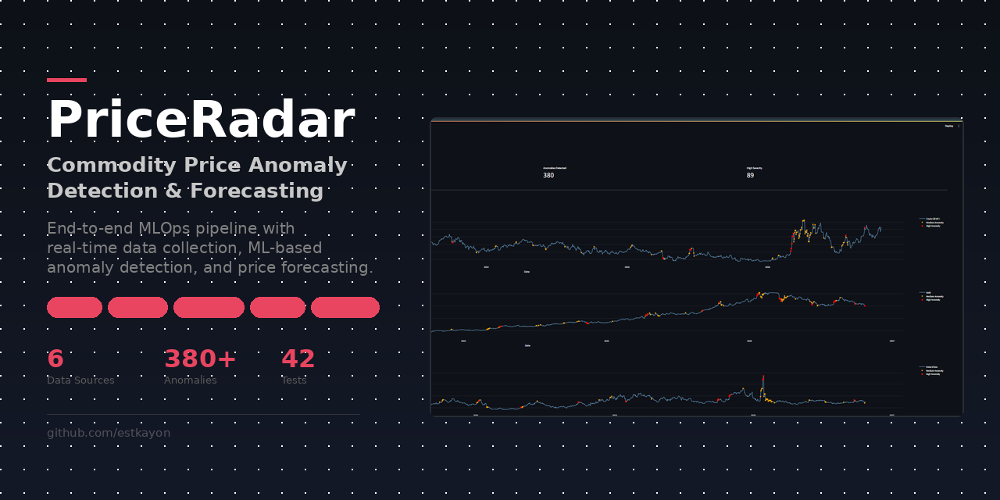
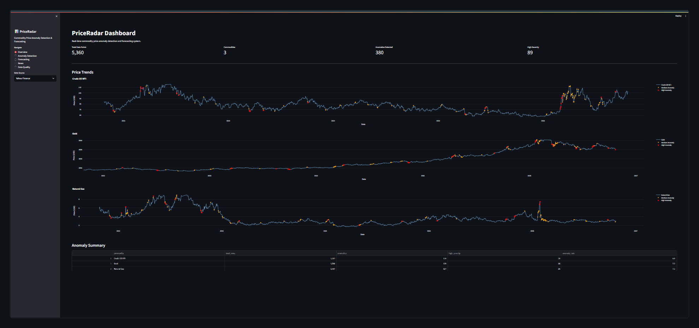

<div align="center">



<br/>
<br/>

<!-- Animated Typing -->
<a href="https://github.com/estkayon/Commodity-Price-Anomaly-Detection">

</a>

<br/>
<br/>

<!-- Badges -->


<br/>

**An end-to-end MLOps pipeline that collects real commodity price data from multiple sources, detects price anomalies using statistical and ML methods, forecasts future prices, and visualizes everything through an interactive dashboard.**

<br/>

[Features](#-features) · [Architecture](#-architecture) · [Dashboard](#-dashboard) · [Setup](#-setup) · [Usage](#-usage) · [Project Structure](#-project-structure) · [Results](#-results) · [Tech Stack](#-tech-stack)

---

</div>

## ✨ Features

<table>
<tr>
<td width="50%">

### 📥 Data Collection
- **Yahoo Finance** — Daily prices for Crude Oil WTI, Natural Gas, Gold with automatic ETF fallback tickers
- **FRED API** — Monthly agricultural prices for Wheat, Rice, Sugar
- **NewsAPI** — Commodity-related news headlines across 9 keyword categories
- 5 years of historical data collected automatically

</td>
<td width="50%">

### 🔍 Anomaly Detection
- **Z-Score Method** — Rolling 30-day statistical deviation analysis
- **Isolation Forest** — ML-based multi-feature pattern detection
- **Combined Scoring** — Flags events detected by either method
- **Severity Classification** — High (both agree) and Medium levels

</td>
</tr>
<tr>
<td width="50%">

### 📈 Price Forecasting
- **Prophet** — Time-series decomposition with weekly and yearly seasonality
- **LightGBM** — Gradient boosting with 40+ engineered features
- Automatic 80/20 train-test split with early stopping
- Per-commodity accuracy metrics (MAE, RMSE, MAPE)

</td>
<td width="50%">

### ⚙️ MLOps & Monitoring
- **MLflow** — Experiment tracking with SQLite backend
- **Evidently AI** — Data quality and drift monitoring
- Automated logging of metrics per model per commodity
- HTML quality reports with statistical analysis

</td>
</tr>
<tr>
<td width="50%">

### 🎨 Interactive Dashboard
- 5 pages: Overview, Anomaly Detection, Forecasting, News, Data Health
- Plotly interactive charts with hover tooltips
- Non-technical friendly labels and explanations
- Dark theme with color-coded severity indicators

</td>
<td width="50%">

### 🧪 Testing & Quality
- 42 automated tests covering all pipeline stages
- Config validation, data quality, feature engineering tests
- Integration tests verifying end-to-end data flow
- Anomaly rate sanity checks

</td>
</tr>
</table>

---

## 🏗 Architecture

```
┌─────────────────────────────────────────────────────────────────────────┐
│                          DATA COLLECTION                                │
│                                                                         │
│   Yahoo Finance ──┐                                                     │
│   (Daily)         │                                                     │
│                   ├──►  Raw CSV Data  ──►  3,770 + 180 + 734 rows      │
│   FRED API ───────┤     (3 sources)                                     │
│   (Monthly)       │                                                     │
│                   │                                                     │
│   NewsAPI ────────┘                                                     │
│   (Headlines)                                                           │
└────────────────────────────────┬────────────────────────────────────────┘
                                 │
                                 ▼
┌─────────────────────────────────────────────────────────────────────────┐
│                       DATA PROCESSING                                   │
│                                                                         │
│   Cleaning                          Feature Engineering                 │
│   ├── Forward fill (5 days)         ├── Technical: SMA, EMA, RSI, MACD │
│   ├── IQR outlier removal           ├── Bollinger Bands, Z-Score       │
│   ├── Deduplication                 ├── Temporal: cyclical encoding     │
│   └── Calendar fill                 └── Lag features (7 windows)       │
│                                                                         │
│   Output: 54 features (Yahoo) · 30 features (FRED)                     │
└────────────────────────────────┬────────────────────────────────────────┘
                                 │
                    ┌────────────┴────────────┐
                    ▼                         ▼
┌────────────────────────────┐   ┌────────────────────────────┐
│    ANOMALY DETECTION       │   │       FORECASTING          │
│                            │   │                            │
│  Z-Score (statistical)     │   │  Prophet (time-series)     │
│  + Isolation Forest (ML)   │   │  + LightGBM (gradient      │
│  = Combined detection      │   │    boosting)               │
│                            │   │                            │
│  380 Yahoo anomalies       │   │  Per-commodity predictions │
│  13 FRED anomalies         │   │  with confidence intervals │
└────────────┬───────────────┘   └──────────────┬─────────────┘
             │                                   │
             └──────────────┬────────────────────┘
                            ▼
┌─────────────────────────────────────────────────────────────────────────┐
│                        MLOPS PIPELINE                                   │
│                                                                         │
│   MLflow Tracking (SQLite)          Evidently AI Monitoring             │
│   ├── 4 experiment runs             ├── 5 data quality reports          │
│   ├── Per-commodity metrics         └── 1 data drift report             │
│   └── MAE, RMSE, MAPE logging                                          │
└────────────────────────────────┬────────────────────────────────────────┘
                                 │
                                 ▼
┌─────────────────────────────────────────────────────────────────────────┐
│                     STREAMLIT DASHBOARD                                  │
│                                                                         │
│   🏠 Overview  ·  🔍 Anomalies  ·  📈 Forecasts  ·  📰 News  ·  📋 Health │
└─────────────────────────────────────────────────────────────────────────┘
```

---

## 📸 Dashboard

<div align="center">



<br/>
<em>Dashboard Overview — Price trends for 3 commodities with anomaly markers and summary statistics</em>

</div>

### Dashboard Pages

| Page | What It Shows |
|------|--------------|
| **🏠 Home** | KPI cards, price trend charts with anomaly markers (orange = moderate, red = major), summary table with key insights |
| **🔍 Unusual Price Changes** | Per-commodity deviation score chart, pattern-based detection visualization, list of all detected events with severity |
| **📈 Price Predictions** | Prophet and LightGBM forecast comparison, actual vs predicted overlay, accuracy metrics (Accuracy %, Average Error, Error Rate) |
| **📰 Latest News** | Filterable commodity news headlines, articles-per-day timeline, source breakdown |
| **📋 Data Health** | Dataset overview with row counts and missing values, embedded Evidently HTML quality reports |

---

## 🛠 Setup

### Prerequisites

- Python 3.11+
- [Anaconda](https://www.anaconda.com/) or [Miniconda](https://docs.conda.io/en/latest/miniconda.html)
- API keys for [FRED](https://fred.stlouisfed.org/docs/api/api_key.html) and [NewsAPI](https://newsapi.org/)

### Installation

```bash
# Clone the repository
git clone https://github.com/estkayon/Commodity-Price-Anomaly-Detection.git
cd Commodity-Price-Anomaly-Detection

# Create conda environment
conda create -n priceradar python=3.11 -y
conda activate priceradar

# Install dependencies
pip install -r requirements.txt
```

### Configuration

1. Create a `.env` file in the project root:

```env
FRED_API_KEY=your_fred_api_key_here
NEWS_API_KEY=your_news_api_key_here
```

2. Review `configs/config.yaml` for default settings (commodities, thresholds, model parameters).

---

## 🚀 Usage

Run each step of the pipeline in order:

### Step 1: Collect Data
```bash
python collect_data.py                    # Collect from all sources
python collect_data.py --source yahoo     # Yahoo Finance only
python collect_data.py --source fred      # FRED API only
python collect_data.py --source news      # NewsAPI only
```

### Step 2: Process & Engineer Features
```bash
python process_data.py                    # Clean + feature engineering
python process_data.py --step clean       # Cleaning only
python process_data.py --step features    # Feature engineering only
```

### Step 3: Detect Anomalies
```bash
python detect_anomalies.py               # All sources
python detect_anomalies.py --source yahoo
python detect_anomalies.py --source fred
```

### Step 4: Run Forecasting Models
```bash
python run_forecast.py                    # All models
python run_forecast.py --model prophet    # Prophet only
python run_forecast.py --model lgbm       # LightGBM only
```

### Step 5: MLOps Tracking & Monitoring
```bash
python run_mlops.py                       # Full MLOps pipeline
python run_mlops.py --step track          # MLflow tracking only
python run_mlops.py --step monitor        # Evidently monitoring only
```

### Step 6: Launch Dashboard
```bash
streamlit run src/dashboard/app.py
```

### Step 7: Run Tests
```bash
pytest tests/test_pipeline.py -v
```

---

## 📁 Project Structure

```
Commodity-Price-Anomaly-Detection/
│
├── collect_data.py                 # Data collection CLI
├── process_data.py                 # Data processing CLI
├── detect_anomalies.py             # Anomaly detection CLI
├── run_forecast.py                 # Forecasting CLI
├── run_mlops.py                    # MLOps pipeline CLI
├── requirements.txt                # Python dependencies
├── .env                            # API keys (not tracked)
├── mlflow.db                       # MLflow SQLite database
│
├── configs/
│   └── config.yaml                 # Central configuration
│
├── src/
│   ├── config_loader.py            # Config & env loader
│   │
│   ├── data/
│   │   ├── yahoo_collector.py      # Yahoo Finance collector (ETF fallback)
│   │   └── fred_collector.py       # FRED API collector
│   │
│   ├── news/
│   │   └── news_collector.py       # NewsAPI collector (9 keywords)
│   │
│   ├── features/
│   │   ├── data_cleaner.py         # Forward fill, IQR, dedup
│   │   └── feature_engineer.py     # 54 technical features
│   │
│   ├── anomaly/
│   │   └── detector.py             # Z-Score + Isolation Forest
│   │
│   ├── models/
│   │   └── forecaster.py           # Prophet + LightGBM
│   │
│   ├── mlops/
│   │   ├── experiment_tracker.py   # MLflow integration
│   │   └── data_monitor.py         # Evidently reports
│   │
│   └── dashboard/
│       └── app.py                  # Streamlit dashboard (5 pages)
│
├── data/
│   ├── raw/                        # Raw collected data
│   ├── processed/                  # Cleaned data
│   ├── features/                   # Engineered features
│   ├── anomalies/                  # Detection results
│   └── forecasts/                  # Model predictions
│
├── reports/
│   └── monitoring/                 # Evidently HTML reports
│
├── tests/
│   └── test_pipeline.py            # 42 pipeline tests
│
└── assets/
    ├── cover.png                   # Project cover image
    └── dashboard_overview.png      # Dashboard screenshot
```

---

## 📊 Results

### Data Collection Summary

| Source | Type | Rows | Period |
|--------|------|------|--------|
| Yahoo Finance | Daily (Oil, Gas, Gold) | 3,770 | 5 years |
| FRED | Monthly (Wheat, Rice, Sugar) | 180 | 5 years |
| NewsAPI | Headlines | 734 | Last 30 days |

### After Processing

| Stage | Yahoo | FRED |
|-------|-------|------|
| Cleaned | 5,360 rows | 180 rows |
| Features | 54 columns | 30 columns |
| Anomalies Detected | 380 | 13 |
| High Severity | 89 | varies |

### Anomaly Detection

| Commodity | Total Days | Anomalies | Major Events | Rate |
|-----------|-----------|-----------|-------------|------|
| Crude Oil WTI | 1,787 | 134 | 28 | 6.5% |
| Gold | 1,786 | 125 | 30 | 7.7% |
| Natural Gas | 1,787 | 121 | 21 | 7.2% |

### Forecasting Models

| Model | Strengths | Used For |
|-------|-----------|----------|
| **Prophet** | Seasonality decomposition, confidence intervals | Yahoo + FRED commodities |
| **LightGBM** | Feature importance, handles non-linear patterns | Yahoo commodities (needs more data) |

### MLOps Tracking

- **4 MLflow experiments** logged with per-commodity MAE, RMSE, MAPE
- **5 Evidently data quality reports** (HTML)
- **1 Evidently data drift report** (first-half vs second-half comparison)

---

## 🔧 Tech Stack

<div align="center">

| Category | Technologies |
|----------|-------------|
| **Language** | Python 3.11 |
| **Data Collection** | yfinance, fredapi, newsapi-python |
| **Data Processing** | pandas, numpy, scikit-learn |
| **Anomaly Detection** | scipy (Z-Score), scikit-learn (Isolation Forest) |
| **Forecasting** | Prophet (Meta), LightGBM (Microsoft) |
| **MLOps** | MLflow 3.17, Evidently AI |
| **Dashboard** | Streamlit, Plotly |
| **Testing** | pytest (42 tests) |
| **Configuration** | PyYAML, python-dotenv |

</div>

---

## 📝 Configuration

All settings are centralized in `configs/config.yaml`:

```yaml
commodities:
  yahoo:                              # Daily price commodities
    - name: "Crude Oil WTI"
      ticker: "CL=F"
    - name: "Natural Gas"
      ticker: "NG=F"
    - name: "Gold"
      ticker: "GC=F"
  fred:                               # Monthly agricultural prices
    - name: "Wheat"
      series_id: "PWHEAMTUSDM"
    - name: "Rice"
      series_id: "PRICENPQUSDM"
    - name: "Sugar"
      series_id: "PSUGAISAUSDM"

anomaly:
  z_score_threshold: 3.0              # Standard deviations for Z-Score
  isolation_forest_contamination: 0.05 # Expected anomaly fraction
  rolling_window_days: 30             # Rolling window for Z-Score

forecasting:
  horizon_days: 90                    # Forecast horizon
  train_test_split: 0.8               # 80% train, 20% test
```

---

## 🤝 Contributing

1. Fork the repository
2. Create your feature branch (`git checkout -b feature/new-feature`)
3. Commit your changes (`git commit -m 'Add new feature'`)
4. Push to the branch (`git push origin feature/new-feature`)
5. Open a Pull Request

---

## 📄 License

This project is open source and available under the [MIT License](LICENSE).

---

<div align="center">

**Built by [Md. Estiak Rahman Ayon](https://github.com/estkayon)**


</div>
